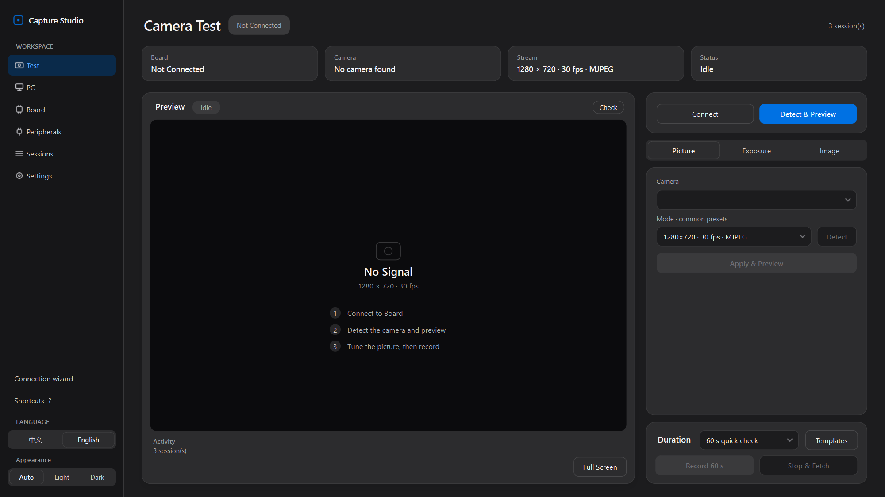
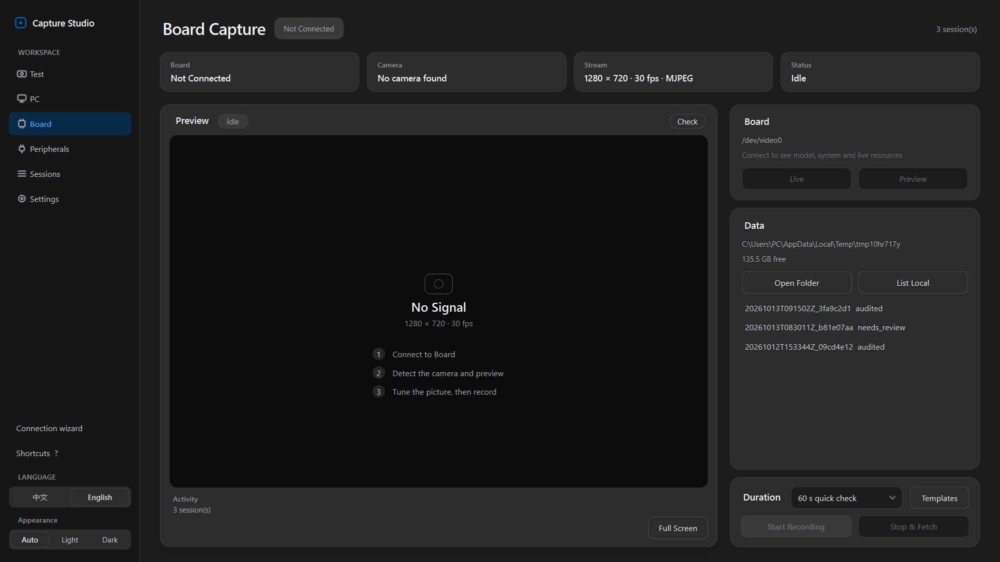
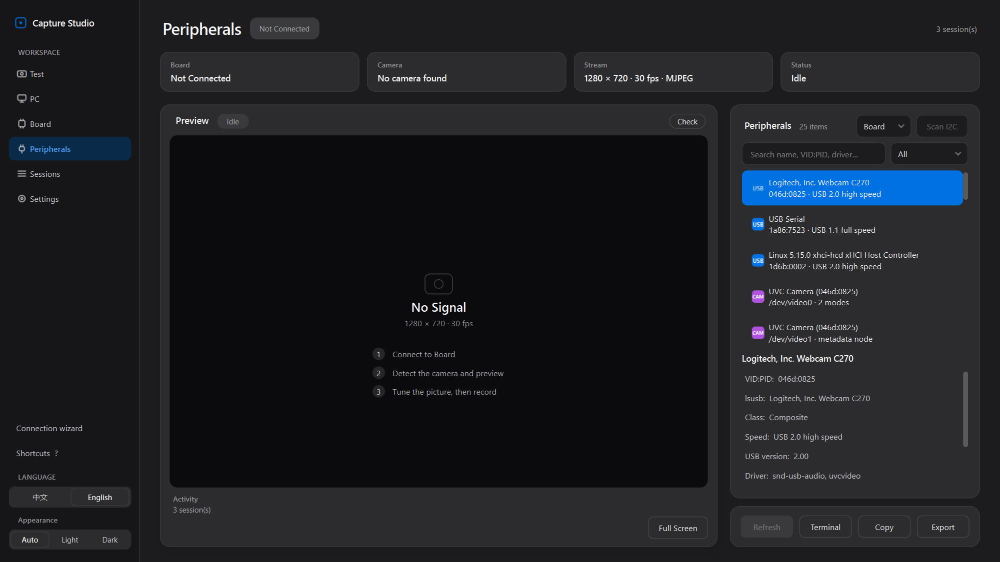

[中文](README.md) | [**English**](README.en.md)

# Capture Studio

Windows app (PySide6) for local USB cameras and SSH boards: **KV260, Jetson, Raspberry Pi, RK3588**, and other Linux boards you can reach over SSH. Chinese / English, light / dark.

## Clone

Current version: **v0.12.9**. The Windows portable build is on [GitHub Releases](https://github.com/nulihou/capture-studio/releases/tag/v0.12.9).

```bash
git clone https://github.com/nulihou/capture-studio.git
cd capture-studio
pip install -r capture_studio/requirements.txt
python -m capture_studio
```

Or double-click `capture_studio\Start-CaptureStudio.cmd`. `Start-KV260-CaptureStudio.cmd` and `Start-BoardCaptureStudio.cmd` open that script.

## Interface

Screenshots are from v0.12.5, at 125% scaling, with no camera attached.

Sidebar: Test, PC, Board, Model Demo, Peripherals, Sessions, Settings.

### Camera test (dark)



Shortcuts: Space record, L live preview, P one frame, F **Large view**, H health check.

### Board (dark)



Discovery (also explained in the connection wizard):

- The **/24** of each real adapter, up to 3 adapters
- The system neighbour table, including **169.254** link-local addresses from a direct cable
- Common **`.local`** names; `zeroconf` browses `_ssh._tcp` when it is installed
- An **SSH-** banner on **TCP 22**
- Vendor tags from the MAC OUI and hostname, with boards listed first
- Written steps when the NIC has only 169.254 or no gateway; **Test this IP** checks one address you type

One discovered board is selected. Several boards are listed for you to choose. A single SSH computer with no board asks you to check the address.

### Model demo


Customer-facing view. The model runs on the board (KV260 DPU, Jetson, RK3588, Ascend, and similar). This PC only receives pictures and results. **Board** reuses the live preview and aligns each frame with `POST /infer`. **F** opens the full-screen show and hides the adjustment controls. The demo/replay badge stays visible. Full screen uses the same light or dark theme as the rest of the app.

Without a board, the page plays a redistributable ground-to-air clip: a small drone against the sky, with offline marks aligned to the airframe (source and license: `capture_studio/assets/demo_clip/ATTRIBUTION.md`). It is labeled **Demo data** — demo marks, not recognition. The default title is “低空小目标检测”. A local video or camera still gets scripted boxes, also labeled demo data. Temperature and CPU in that mode are labeled **Sample meters, not the board**. A session can be saved as JSONL and replayed. Title, customer name, and logo position are set on the page.

Protocol and the minimal on-board sender: [`capture_studio/docs/inference_protocol.md`](capture_studio/docs/inference_protocol.md).


Dark page, dark full screen, and the disconnected board source: `docs/screenshots/v12/zh_dark_model_demo.png`, `zh_dark_model_demo_full.png`, `zh_dark_model_demo_board.png`.

### Peripherals (dark)



## Requirements

- Windows 10/11, Python 3.10+: `pip install -r capture_studio/requirements.txt`
- OpenSSH Client; reachable board (same subnet, direct-link static IP, or typed IP)
- FFmpeg / FFprobe for local capture and checks

## Use

```powershell
git clone https://github.com/nulihou/capture-studio.git
cd capture-studio
pip install -r capture_studio/requirements.txt
python -m capture_studio
```

The Capture Studio SSH key is stored as `~/.ssh/id_ed25519_kv260`, so boards that already trust that key keep working. Recording length can be a 60-second check, a 10-minute gate, a custom time from 10 seconds to 2 hours, or manual stop. **Settings** can look up a newer build on GitHub Releases.

On a board with xmutil, the left navigation shows **FPGA app** under the workspace buttons. It shows the loaded app. **Load FPGA** takes a compiled app folder (`shell.json`, one `.xclbin`, one `.dtbo`, or a zip of that folder), copies it to `/lib/firmware/xilinx/<app>`, and runs `xmutil loadapp`. A `vart.conf` in the folder is installed as `/etc/vart.conf`.

## Tests

Run from a repo-root clone layout (`test_ui.py` opens a Tk window and is skipped by default):

```powershell
cd capture_studio\tests
$env:PYTHONPATH = (Resolve-Path ..\..).Path
$env:QT_QPA_PLATFORM = "offscreen"
python -m unittest discover -v -p "test_[!u]*.py"
python ..\ui_redesign\smoke_ui.py capture_studio
```

## Portable zip

`CaptureStudio_v<version>_windows_x64.zip` → run `CaptureStudio.exe`.
