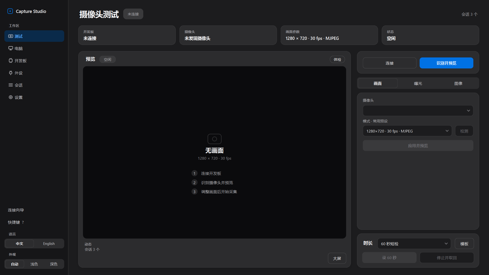
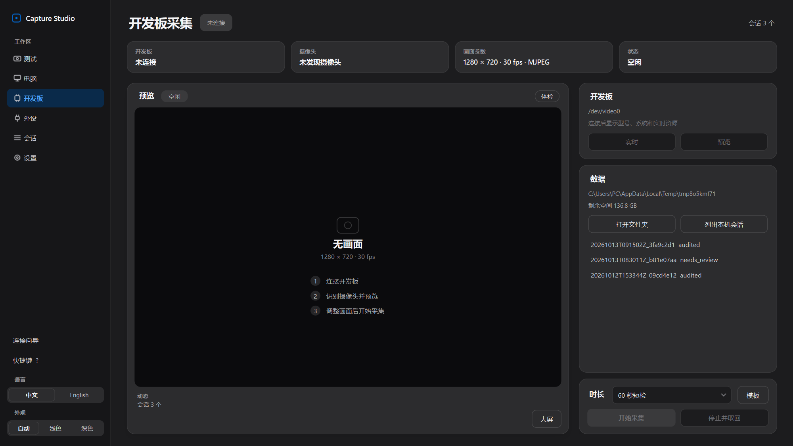
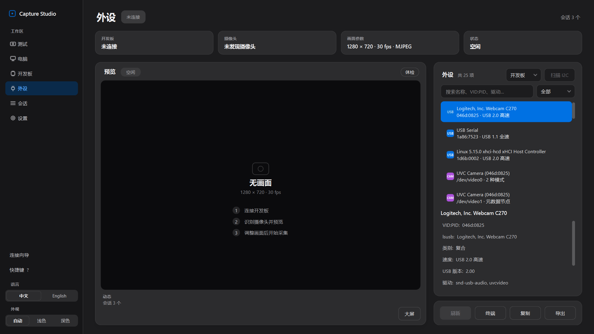
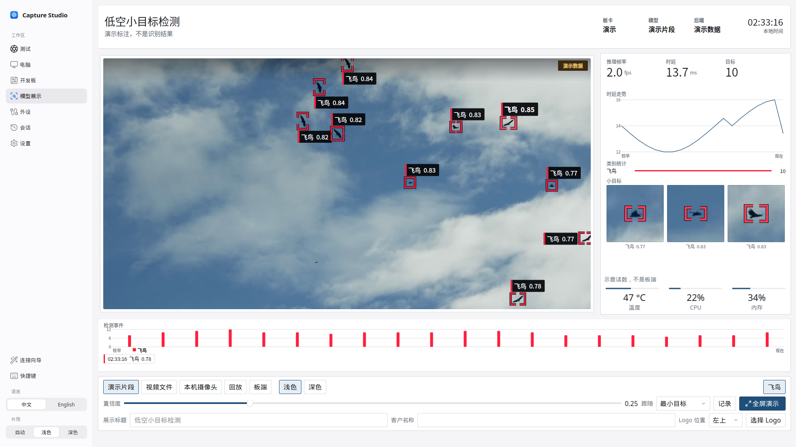
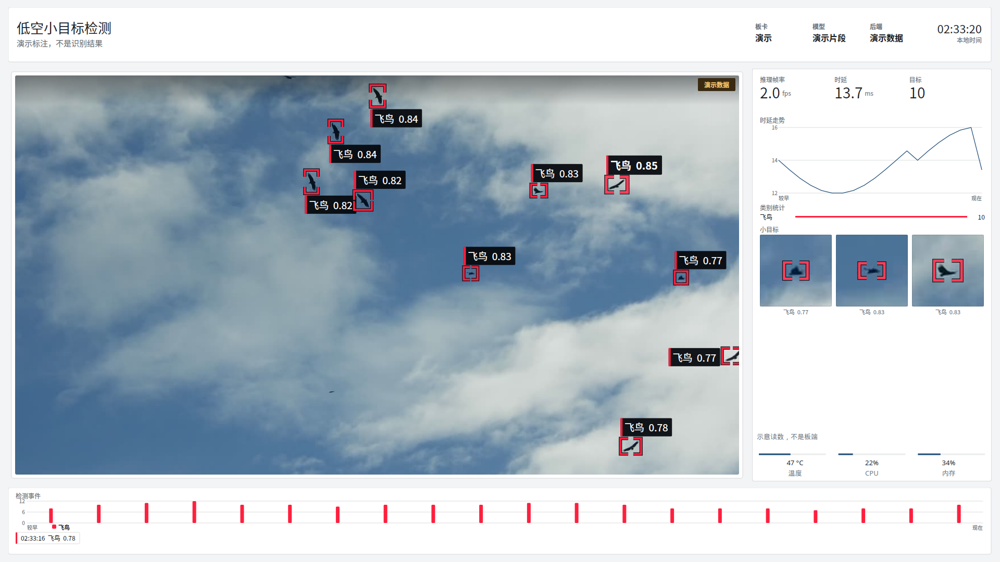

[**中文**](README.md) | [English](README.en.md)

# Capture Studio

Windows 桌面程序（PySide6）：本机 USB 摄像头采集，以及通过 SSH 为 **KV260、Jetson、树莓派、RK3588** 和其他可 SSH 访问的 Linux 开发板做采集与调试。界面有中文 / English，浅色 / 深色。

## 克隆

当前版本 **v0.12.9**。Windows 便携包在 [GitHub Release](https://github.com/nulihou/capture-studio/releases/tag/v0.12.9)。

```bash
git clone https://github.com/nulihou/capture-studio.git
cd capture-studio
pip install -r capture_studio/requirements.txt
python -m capture_studio
```

或双击 `capture_studio\Start-CaptureStudio.cmd`。`Start-KV260-CaptureStudio.cmd` 和 `Start-BoardCaptureStudio.cmd` 会转到这个脚本。

## 界面

截图来自 v0.12.5，比例 125%，当时没有接摄像头。

左侧：测试、电脑、开发板、模型展示、外设、会话、设置。

### 摄像头测试（深色）



顶部四格为开发板、摄像头、画面参数和状态。左侧预览；右侧画面 / 曝光 / 图像。快捷键：Space 开始/停止，L 实时预览，P 预览一帧，F 大屏（Large view），H 采集前体检。

### 开发板（深色）



未连接时用**连接向导**或快速扫描。发现规则（与向导内说明一致）：

- 每块真实网卡所在的 **/24**，最多 3 块
- 系统邻居表（ARP / Get-NetNeighbor），包括直连、没有 DHCP 时的 **169.254** 地址
- 常见 **`.local`** 名称（kria、ubuntu、raspberrypi、jetson、rockchip 等）；装了 `zeroconf` 时会浏览 `_ssh._tcp`
- 用 **TCP 22** 的 `SSH-` 应答确认是 SSH
- 按 MAC OUI 和名称标注厂商，开发板排在前面，普通 Linux / Windows PC 也会标出来
- 有线网卡只有 169.254 或没有网关时，界面写出直连时怎么设地址；也可以手填 IP，再点 **测试这个 IP**

只发现一块开发板时会选中它。有多块时列出地址，由使用者选择。没有开发板、只有一台 SSH 设备时，界面会提示核对。

连接后显示型号、系统、CPU、内存、温度、磁盘等（KV260 / Zynq / Jetson / 树莓派 / RK3588 等可识别）。

### 外设（深色）



USB、视频、串口、I2C、SPI、网络、存储、音频、GPIO、显示等；可搜索、筛选、串口终端与导出。

### 模型展示



给客户看的演示页。模型在开发板上跑（KV260 DPU、Jetson、RK3588、昇腾等），这台电脑只接收画面和识别结果。来源选 **板端** 时，沿用已有实时预览，并按帧对齐板端 `POST /infer` 的结果。快捷键 **F**（或「全屏演示」）进入大屏，调节类控件会隐藏，演示/回放标记仍留在画面上。全屏跟随这一页自己的浅色或深色（默认浅色），不改其他页面的主题。

没有板子时，默认播放一段可再分发的地对空片段：地面仰拍，天空里有一群飞鸟（来源和许可见 `capture_studio/assets/demo_clip/ATTRIBUTION.md`）。框是离线对照画面标出的演示标注，贴着大部分可见的鸟，不是电脑上的识别结果。检测框带深色描边，浅色和深色、普通页和全屏都能看清；小目标画廊是正方形，画面不拉伸。画面上标为 **演示数据**，说明是「演示标注，不是识别结果」。默认标题是「低空小目标检测」。这一页自己记住浅色或深色，默认浅色，不改其他页面的主题。本地视频或本机摄像头仍只用脚本框，同样标成演示数据。这时的温度和 CPU 标成 **示意读数，不是板端**。切换来源会清掉上一段的帧率、时延、计数和事件。也可以把一段结果存成 JSONL 再 **回放**。标题、客户名称和 Logo 位置可在页面底部设置。

协议和板端最小脚本见 [`capture_studio/docs/inference_protocol.md`](capture_studio/docs/inference_protocol.md)。

全屏演示（浅色）：



深色页面与全屏见 `docs/screenshots/v12/zh_dark_model_demo.png`、`zh_dark_model_demo_full.png`。浅色下把来源切到板端且未连接：`zh_light_model_demo_board.png`。

## 准备

- Windows 10/11，Python 3.10+：`pip install -r capture_studio/requirements.txt`（`keyring` 用于记住密码；可选 `zeroconf` 增强 mDNS）
- Windows OpenSSH 客户端
- 电脑与开发板网络可达（同网段、或直连后按指引设静态 IP、或手填 IP）
- 开发板已能 SSH；Kria 默认用户常为 `ubuntu`
- 板上需 Python 3、GStreamer、gcc（首次连接写入采集服务）
- 本机采集/校验需要 FFmpeg、FFprobe（PATH 或设置页指定）

## 使用

```powershell
git clone https://github.com/nulihou/capture-studio.git
cd capture-studio
pip install -r capture_studio/requirements.txt
python -m capture_studio
```

1. 若本机还没有密钥，会生成 **Capture Studio SSH 密钥**（文件仍为 `~/.ssh/id_ed25519_kv260`，兼容已装过公钥的板）。
2. 用连接向导扫描或手填地址；按上面的发现规则理解结果。
3. 新板第一次可填登录密码以安装公钥（可选「记住密码」→ Windows 凭据管理器）；之后用密钥。
4. 保存并连接；软件在板上部署/启动采集服务。
5. 在「摄像头测试」或「开发板采集」页用 **大屏** 看画面。时长可选 60 秒短检、10 分钟关口、自定义（10 秒到 2 小时）或手动停止。
6. 加载 FPGA：连上带 xmutil 的开发板后，左侧导航里、工作区按钮下面有 **FPGA 编译文件**。这里显示当前应用。点 **加载 FPGA**，选择编好的应用目录（含 `shell.json`、`.xclbin`、`.dtbo`，也可以是只含这一份应用的 zip）。软件把它装到 `/lib/firmware/xilinx/<应用名>`，执行 `xmutil loadapp`，目录里若有 `vart.conf` 会写到 `/etc/vart.conf`。
7. **设置**页可以查看 GitHub Releases 上的新版本。

## 测试

```powershell
cd capture_studio\tests
$env:PYTHONPATH = (Resolve-Path ..\..).Path
$env:QT_QPA_PLATFORM = "offscreen"
python -m unittest discover -v -p "test_[!u]*.py"
python ..\ui_redesign\smoke_ui.py capture_studio
```

（在仓库根克隆布局下执行；`test_ui.py` 会开 Tk 窗口，默认跳过。）

## 便携包

Release 资产：`CaptureStudio_v<version>_windows_x64.zip`。解压后运行 `CaptureStudio.exe`。
