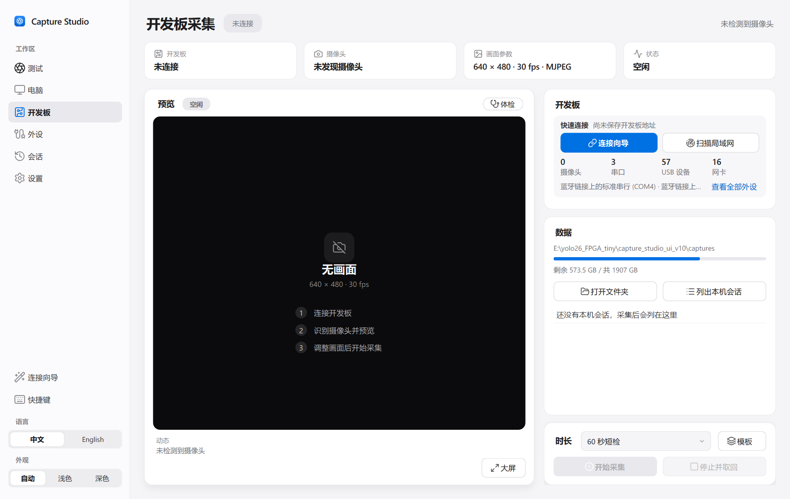
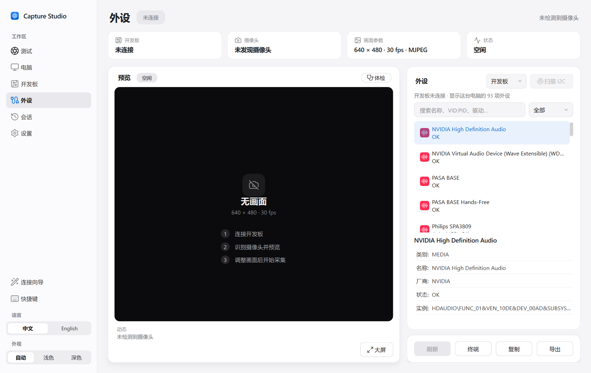
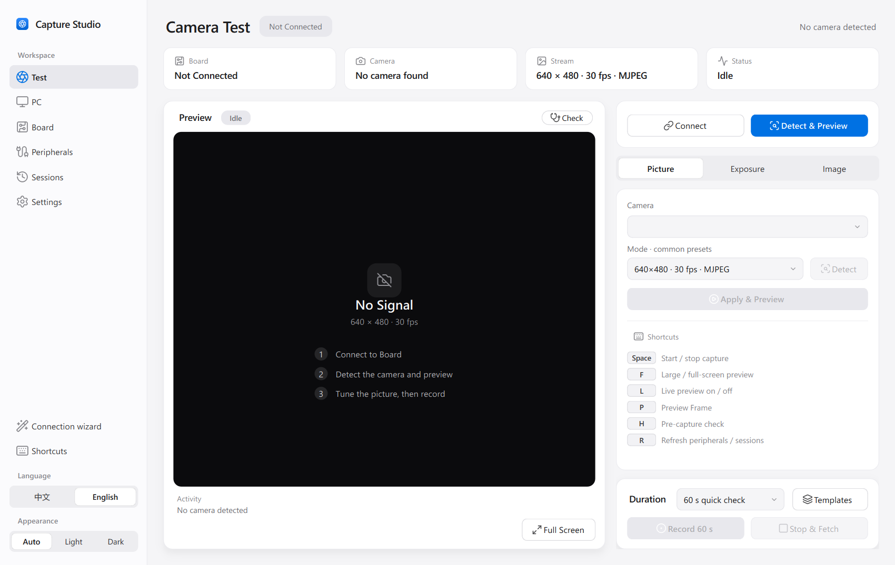
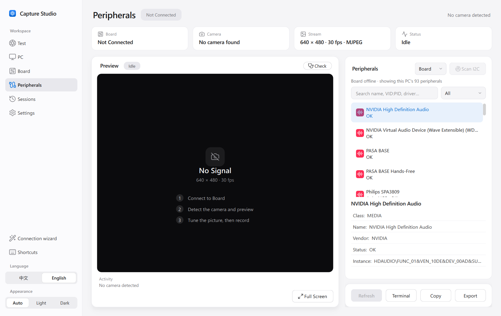

# 开发板采集工作室 / Board Capture Studio

> 仓库名 `nulihou/kv260-capture-studio` 为历史保留；产品名是 Board Capture Studio。Python 包名仍是 `capture_studio`。
>
> The GitHub repo slug is legacy; the product name is **Board Capture Studio**. The Python package remains `capture_studio`.

[中文](#中文) · [English](#english)

## 中文

Windows 程序，用来给一块新的 KV260 采集 USB 摄像头数据。连接时会把采集服务装到板上。每台电脑自己生成 SSH 密钥，每块板自己生成访问令牌。

### 界面（v0.11）

新界面基于 PySide6（Qt），左侧导航分为：测试、电脑、开发板、外设、会话、设置。支持中文 / English、浅色 / 深色。截图在 125% 缩放、未接摄像头、未连接开发板时截取。

#### 摄像头测试


顶部四格依次是开发板、摄像头、画面参数和状态。左边是预览区，未出画面时显示三步引导。右边有三个标签：画面、曝光、图像，用来选择摄像头、模式和参数。底部选择时长和模板，然后开始采集。快捷键：Space 开始 / 停止，L 实时预览，P 预览一帧，F 大屏，H 采集前体检。

#### 开发板



未连接时显示“快速连接”：连接向导，扫描局域网（只看 22 端口的 SSH 应答，自动跳过虚拟网卡和代理的假 IP），以及本机摄像头、串口、USB 和网卡的数量。连接后显示型号、系统、CPU、内存、温度、磁盘、FPGA 状态。支持 KV260、Zynq、Jetson、树莓派和 RK3588 的识别。

#### 外设



列出开发板或这台电脑上的 USB、视频、串口、I2C、SPI、网络、存储、音频、GPIO 和显示设备，每项带 VID:PID、驱动和参数。可以搜索和按类别筛选，也可以打开串口终端、复制，或导出 JSON / TXT 清单。开发板未连接时显示本机外设。

### 准备

- Windows 10 或 11，Python 3.10 及以上，并安装 `PySide6`；串口终端需要 `pyserial`，“记住密码”需要 `keyring`（可选）。
  `pip install PySide6 pyserial keyring`
- Windows 自带的 OpenSSH 客户端。在“可选功能”里确认有 OpenSSH Client。
- 电脑和开发板在同一网络。
- 开发板已烧录并完成第一次启动，能用 SSH 登录。Kria Ubuntu 的默认用户一般是 `ubuntu`。
- 板上需要 Python 3、GStreamer 和 gcc。采集服务在第一次连接时写入 `/home/ubuntu/capture_studio`。
- 电脑上若要做本机摄像头采集或取回后的校验，需要 FFmpeg 和 FFprobe，可放进系统 PATH，或在界面里指定路径。

### 使用

```powershell
git clone https://github.com/nulihou/kv260-capture-studio.git
cd kv260-capture-studio
python -m capture_studio
```

也可以双击 `capture_studio\Start-BoardCaptureStudio.cmd`。

1. 这台电脑还没有私钥时，软件生成 `~/.ssh/id_ed25519_kv260`。
2. 同一网络只有一块 Xilinx 开发板时，IP 会自动填上。看到多块时列出地址，选中要用的那一块。板端目录保持 `/home/ubuntu/capture_studio`。摄像头序号留空；只接一只摄像头时会自动选用。
3. 新板第一次填写登录密码。软件只把本机公钥装到这块板，密码不保存。之后用密钥连接。
4. 保存并连接。软件在板上创建目录、放入当前采集程序并启动。
5. 在「摄像头测试」或「KV260 采集」页点画面下方的「大屏」。滚轮放大，按住拖动，Esc 关闭。640×480 原样显示；1920×1080 的预览长边为 1280。
6. 对准之后再录。开始录制时预览会停，录制期间大屏没有画面。

### 测试

```powershell
cd capture_studio\tests
$env:PYTHONPATH = (Resolve-Path ..\..).Path
$env:QT_QPA_PLATFORM = "offscreen"
python -m unittest discover -v -p "test_[!u]*.py"   # test_ui.py opens Tk windows; skip it
python ..\ui_redesign\smoke_ui.py capture_studio
```

### 仓库里有什么

本仓库包含 Windows 采集程序和测试。SSH 密钥、板端令牌、已保存的开发板地址和已采集的录像在每台电脑、每块板上各自生成。SD 卡镜像、FPGA 镜像和模型另备；数据采集本身使用上面的程序即可。

## English

A Windows program for capturing USB camera data on a newly purchased KV260. Connecting installs the capture service on the board. Each computer creates its own SSH key, and each board creates its own access token.

### Interface (v0.11)

The new interface is built on PySide6 (Qt). The sidebar has Test, PC, Board, Peripherals, Sessions and Settings. Both 中文 / English and light / dark themes are available. Screenshots were taken at 125% scaling with no camera attached and no board connected.

#### Camera test



The four tiles at the top show the board, the camera, the stream settings and the status. The preview is on the left; until a picture arrives it shows three getting-started steps. On the right, the Picture, Exposure and Image tabs pick the camera, the mode and the controls. At the bottom, choose a duration or a template, then record. Shortcuts: Space starts or stops recording, L toggles live preview, P previews one frame, F opens the large view, and H runs the pre-capture check.

#### Board


When no board is connected, the page shows Quick connect: the connection wizard, a LAN scan (an SSH banner check on port 22 only, skipping virtual adapters and proxy fake IPs) and counts of this PC's cameras, serial ports, USB devices and network adapters. Once connected, it shows the model, OS, CPU, memory, temperature, disk and FPGA state. KV260, Zynq, Jetson, Raspberry Pi and RK3588 boards are recognised.

#### Peripherals



This page lists USB, video, serial, I2C, SPI, network, storage, audio, GPIO and display devices on the board or on this PC, each with its VID:PID, driver and parameters. You can search and filter by category, open a serial terminal, copy entries, or export the inventory as JSON and TXT. With no board connected, it shows this PC's devices.

### Requirements

- Windows 10 or 11 with Python 3.10 or newer and `PySide6`; `pyserial` for the serial terminal, `keyring` (optional) for Remember password.
  `pip install PySide6 pyserial keyring`
- The OpenSSH Client that ships with Windows. Confirm it under Optional Features.
- The computer and the board on the same network.
- A board that has been flashed, has completed first boot, and accepts SSH. The usual Kria Ubuntu user is `ubuntu`.
- Python 3, GStreamer, and gcc on the board. The first connection writes the capture service to `/home/ubuntu/capture_studio`.
- FFmpeg and FFprobe on the computer for local-camera capture and for checking files after retrieval. Put them on `PATH`, or set their paths in the interface.

### Use

```powershell
git clone https://github.com/nulihou/kv260-capture-studio.git
cd kv260-capture-studio
python -m capture_studio
```

Or double-click `capture_studio\Start-BoardCaptureStudio.cmd`.

1. If this computer has no key yet, the program creates `~/.ssh/id_ed25519_kv260`.
2. When the network shows exactly one Xilinx board, its IP is filled in. When several boards appear, the program lists them and waits for a choice. Leave the board directory as `/home/ubuntu/capture_studio`. Leave the camera serial blank; a single connected camera is selected automatically.
3. On the first connection to a new board, enter its login password once. The program installs this computer’s public key and does not store the password. Later connections use the key.
4. Save and connect. The program creates the directory on the board, copies the current capture program, and starts it.
5. On the Camera test or KV260 capture page, use **大屏** under the picture. The wheel zooms in, dragging pans, and Esc closes the window. A 640×480 frame is shown at full resolution. A 1920×1080 preview arrives with a 1280-pixel long edge.
6. Start recording after the camera is aimed. Recording stops the preview, so the large view is blank while a recording is in progress.

### Tests

```powershell
cd capture_studio\tests
$env:PYTHONPATH = (Resolve-Path ..\..).Path
$env:QT_QPA_PLATFORM = "offscreen"
python -m unittest discover -v -p "test_[!u]*.py"   # test_ui.py opens Tk windows; skip it
python ..\ui_redesign\smoke_ui.py capture_studio
```

### What this repository contains

This repository contains the Windows capture program and its tests. SSH keys, board tokens, saved board addresses, and recorded video are created on each computer and each board. SD card images, FPGA images, and models are kept separately; data collection uses the program above.