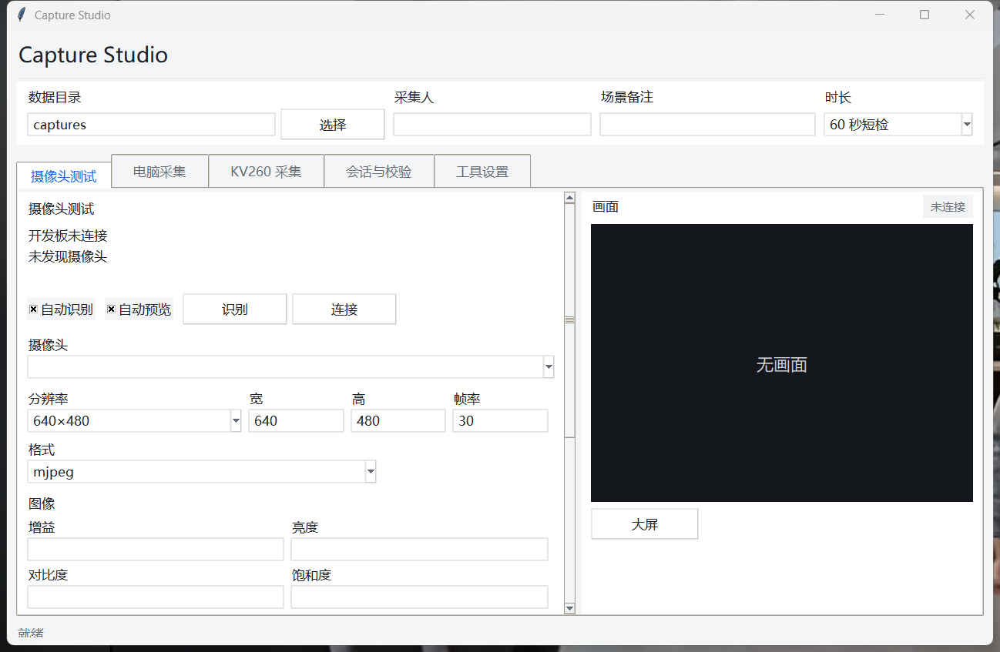
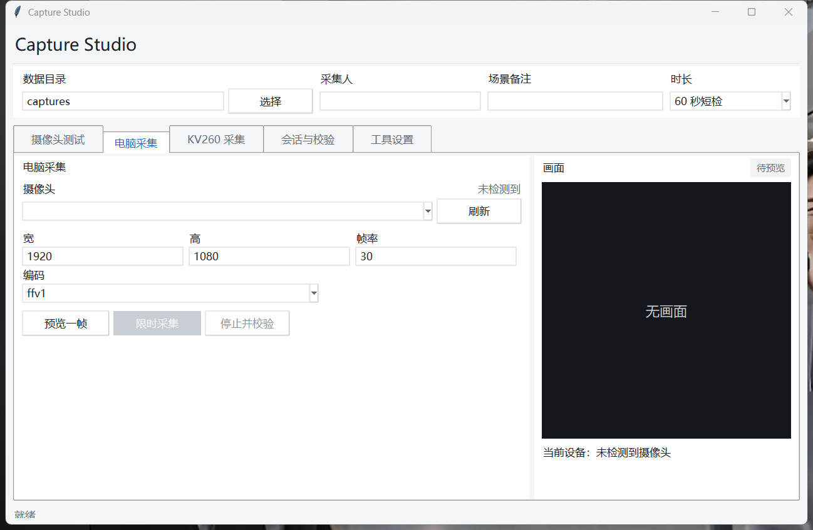
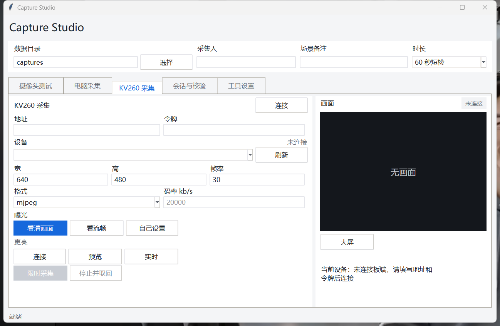
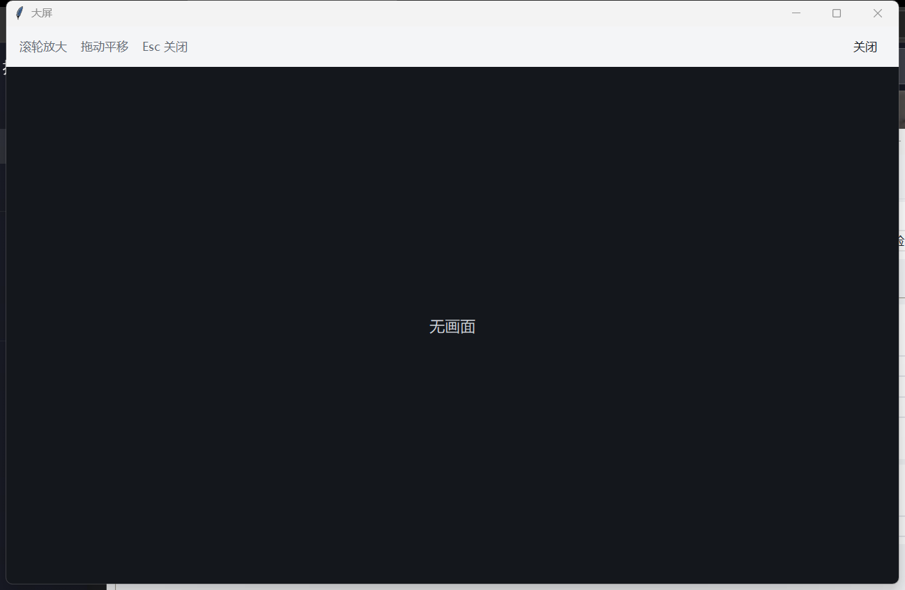
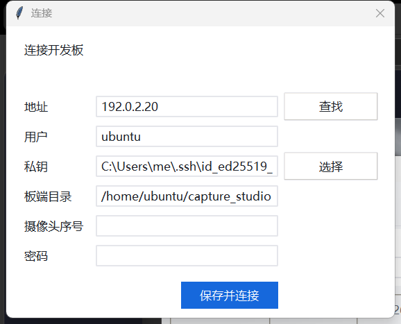
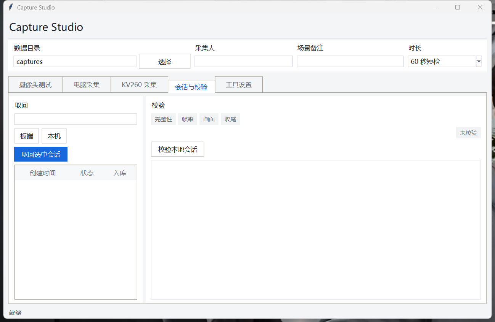
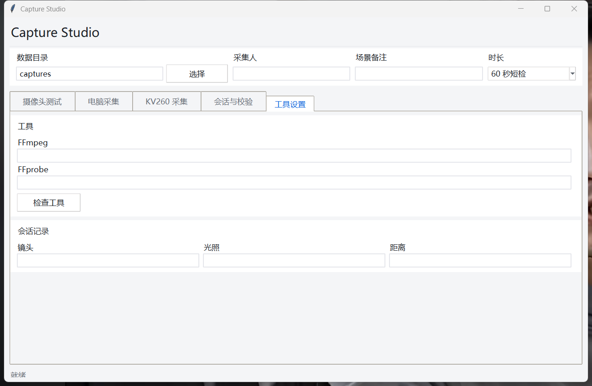

# KV260 数据采集 / KV260 Capture Studio

[中文](#中文) · [English](#english)

## 中文

Windows 程序，用来给一块新的 KV260 采集 USB 摄像头数据。连接时会把采集服务装到板上。每台电脑自己生成 SSH 密钥，每块板自己生成访问令牌。

下面的界面截图在尚未连接摄像头时截取，画面区显示「无画面」。连接成功后，同一位置显示摄像头画面。连接窗口里的地址、用户和私钥是示例。

### 界面

顶栏各项写入每一次采集：数据目录、采集人、场景备注、时长。时长为「60 秒短检」时，采集按钮显示「限时采集」。

#### 摄像头测试



开发板和摄像头的状态写在左侧。自动识别、自动预览打开时，插上后会自己连接并出画面；识别和连接可以手动执行。下面选择摄像头、分辨率、格式，以及增益、亮度、白平衡、对焦。空白数字不会改摄像头当前值。应用并预览按这些参数出画面，读取参数列出这只摄像头实际能调的项，填入当前把读到的数填进输入框，清空把数字留空。录 60 秒并检查会先停掉预览再录制。右侧是画面，大屏打开全窗口查看。

#### 电脑采集



摄像头插在这台 Windows 电脑上时使用这一页。刷新列出本机摄像头。宽、高、帧率和编码决定这一次采集。预览一帧只取一张图，限时采集按顶栏时长录制，停止并校验结束并检查文件。

#### KV260 采集



摄像头插在开发板上时使用这一页。地址和令牌在连接成功后由程序填入。刷新列出板上的视频设备。看清画面偏亮，看流畅使用更快的快门，自己设置才显示曝光数字。预览取一帧，实时连续刷新右侧画面。开始采集后预览停止，视频留在板上；停止并取回把文件拷回电脑并校验。

#### 大屏



从摄像头测试或 KV260 采集页的「大屏」打开。640×480 按采集分辨率显示。滚轮继续放大，按住拖动，Esc 或关闭离开。录制进行时这一页没有画面。

#### 连接



查找在当前网络里寻找开发板。只看到一块 Xilinx 板时，地址会填上。私钥不存在时，程序在这台电脑生成 `id_ed25519_kv260`。新板第一次在密码框填写登录密码，程序只安装公钥，不保存密码。摄像头序号留空，并且只接了一只摄像头时，自动选用那一只。保存并连接把当前采集程序装到板端目录并启动。

#### 会话与校验



左侧列出板上或本机的采集会话，取回选中会话把板上的文件拷回来。右侧四项分别是完整性、帧率、画面、收尾。校验本地会话检查已经在电脑上的一次采集，结果写在下面的记录里。

#### 工具设置



FFmpeg 和 FFprobe 留空时使用系统 PATH。检查工具确认两者可用。镜头、光照、距离随会话保存。

### 准备

- Windows 10 或 11，已安装 Python 3.10 及以上，并且带 Tkinter。官方 Python 安装时勾选 tcl/tk。
- Windows 自带的 OpenSSH 客户端。在“可选功能”里确认有 OpenSSH Client。
- 电脑和开发板在同一网络。
- 开发板已烧录并完成第一次启动，能用 SSH 登录。Kria Ubuntu 的默认用户一般是 `ubuntu`。
- 板上需要 Python 3、GStreamer 和 gcc。采集服务在第一次连接时写入 `/home/ubuntu/capture_studio`。
- 电脑上若要做本机摄像头采集或取回后的校验，需要 FFmpeg 和 FFprobe，可放进系统 PATH，或在界面里指定路径。

### 使用

```powershell
git clone https://github.com/nulihou/kv260-capture-studio.git
cd kv260-capture-studio
python -m capture_studio.portable_connect
```

也可以双击 `capture_studio\Start-KV260-CaptureStudio.cmd`。

1. 这台电脑还没有私钥时，软件生成 `~/.ssh/id_ed25519_kv260`。
2. 同一网络只有一块 Xilinx 开发板时，IP 会自动填上。看到多块时列出地址，选中要用的那一块。板端目录保持 `/home/ubuntu/capture_studio`。摄像头序号留空；只接一只摄像头时会自动选用。
3. 新板第一次填写登录密码。软件只把本机公钥装到这块板，密码不保存。之后用密钥连接。
4. 保存并连接。软件在板上创建目录、放入当前采集程序并启动。
5. 在「摄像头测试」或「KV260 采集」页点画面下方的「大屏」。滚轮放大，按住拖动，Esc 关闭。640×480 原样显示；1920×1080 的预览长边为 1280。
6. 对准之后再录。开始录制时预览会停，录制期间大屏没有画面。

### 测试

```powershell
cd capture_studio\tests
$env:PYTHONPATH = (Resolve-Path ..\..).Path
python -m unittest discover -v
```

### 仓库里有什么

本仓库包含 Windows 采集程序和测试。SSH 密钥、板端令牌、已保存的开发板地址和已采集的录像在每台电脑、每块板上各自生成。SD 卡镜像、FPGA 镜像和模型另备；数据采集本身使用上面的程序即可。

## English

A Windows program for capturing USB camera data on a newly purchased KV260. Connecting installs the capture service on the board. Each computer creates its own SSH key, and each board creates its own access token.

The screenshots below were taken before a camera was connected, so the picture area reads “无画面” (no picture). After a successful connection, the camera image appears in that same area. The address, user, and key in the connection window are examples.

### Interface

The top bar is stored with every capture: data directory, operator, scene note, and duration. When the duration is “60 秒短检”, the record button reads “限时采集”.

#### Camera test


Board and camera status sit on the left. With auto-identify and auto-preview on, plugging in connects and shows a picture; Identify and Connect run the same steps by hand. Below that are the camera, resolution, format, and image controls such as gain, brightness, white balance, and focus. A blank number leaves the camera’s current value unchanged. Apply and preview shows the picture with these settings. Read parameters lists what this camera actually exposes. Fill current copies those values into the fields, and Clear blanks them. Record 60 seconds and check stops the preview, then records. The picture is on the right. Large view opens it in its own window.

#### PC capture


Use this page when the camera is plugged into the Windows computer. Refresh lists local cameras. Width, height, frame rate, and codec apply to this capture. Preview one frame grabs a single image. Timed capture records for the duration in the top bar. Stop and check ends the recording and inspects the file.

#### KV260 capture


Use this page when the camera is plugged into the board. Address and token are filled in after a successful connection. Refresh lists the video devices on the board. “看清画面” favors a brighter picture, “看流畅” uses a faster shutter, and “自己设置” reveals the exposure number. Preview grabs one frame. Live updates the picture continuously. Starting a capture stops the preview and leaves the video on the board. Stop and retrieve copies the files back and checks them.

#### Large view


Open it with “大屏” on the Camera test or KV260 capture page. A 640×480 frame is shown at capture resolution. The wheel zooms further, dragging pans, and Esc or Close leaves the window. This view is empty while a recording is in progress.

#### Connection


Find searches the current network for a board. When exactly one Xilinx board is visible, its address is filled in. If no key exists yet, the program creates `id_ed25519_kv260` on this computer. The first time a new board is used, type its login password once. The program installs the public key and does not store the password. Leave the camera serial blank when only one camera is attached; that camera is selected. Save and connect copies the current capture program into the board directory and starts it.

#### Sessions and checks


The left side lists capture sessions on the board or on this computer. Retrieve selected session copies a board session back. The four checks are integrity, frame rate, image, and closeout. Check local session inspects a capture already on the computer, and the result is written in the log below.

#### Tool settings


Leave FFmpeg and FFprobe empty to use the system PATH. Check tools confirms both are available. Lens, lighting, and distance are stored with the session.

### Requirements

- Windows 10 or 11 with Python 3.10 or newer, including Tkinter. Select tcl/tk in the official Python installer.
- The OpenSSH Client that ships with Windows. Confirm it under Optional Features.
- The computer and the board on the same network.
- A board that has been flashed, has completed first boot, and accepts SSH. The usual Kria Ubuntu user is `ubuntu`.
- Python 3, GStreamer, and gcc on the board. The first connection writes the capture service to `/home/ubuntu/capture_studio`.
- FFmpeg and FFprobe on the computer for local-camera capture and for checking files after retrieval. Put them on `PATH`, or set their paths in the interface.

### Use

```powershell
git clone https://github.com/nulihou/kv260-capture-studio.git
cd kv260-capture-studio
python -m capture_studio.portable_connect
```

Or double-click `capture_studio\Start-KV260-CaptureStudio.cmd`.

1. If this computer has no key yet, the program creates `~/.ssh/id_ed25519_kv260`.
2. When the network shows exactly one Xilinx board, its IP is filled in. When several boards appear, the program lists them and waits for a choice. Leave the board directory as `/home/ubuntu/capture_studio`. Leave the camera serial blank; a single connected camera is selected automatically.
3. On the first connection to a new board, enter its login password once. The program installs this computer’s public key and does not store the password. Later connections use the key.
4. Save and connect. The program creates the directory on the board, copies the current capture program, and starts it.
5. On the Camera test or KV260 capture page, use **大屏** under the picture. The wheel zooms in, dragging pans, and Esc closes the window. A 640×480 frame is shown at full resolution. A 1920×1080 preview arrives with a 1280-pixel long edge.
6. Start recording after the camera is aimed. Recording stops the preview, so the large view is blank while a recording is in progress.

### Tests

```powershell
cd capture_studio\tests
$env:PYTHONPATH = (Resolve-Path ..\..).Path
python -m unittest discover -v
```

### What this repository contains

This repository contains the Windows capture program and its tests. SSH keys, board tokens, saved board addresses, and recorded video are created on each computer and each board. SD card images, FPGA images, and models are kept separately; data collection uses the program above.
